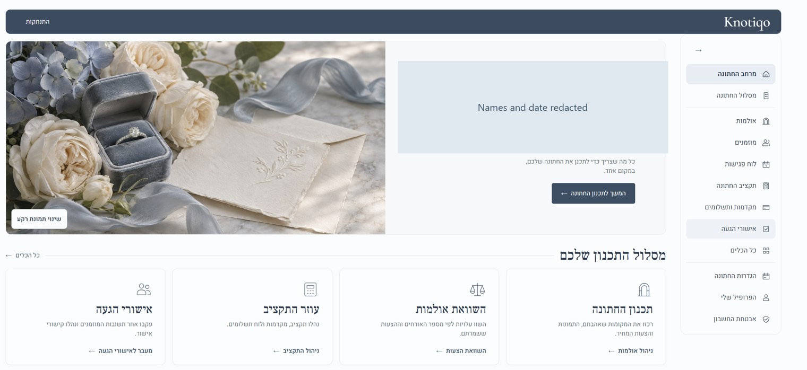
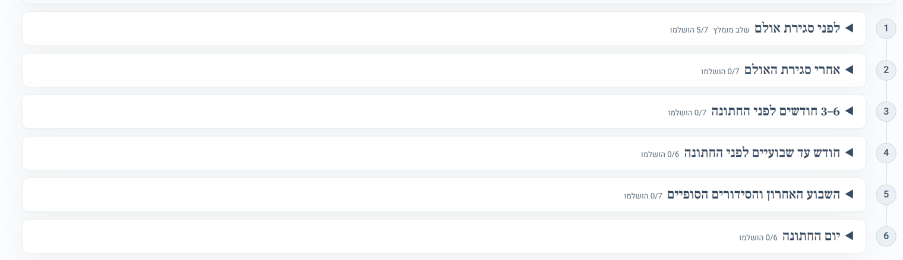
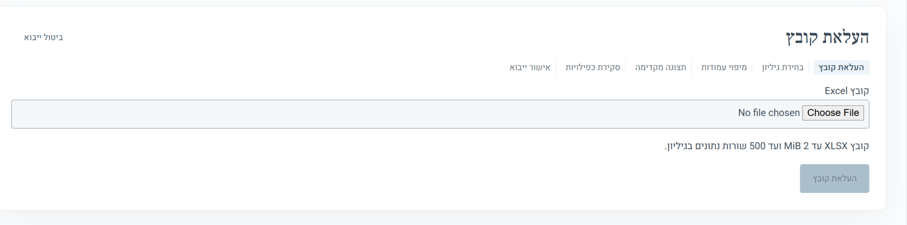
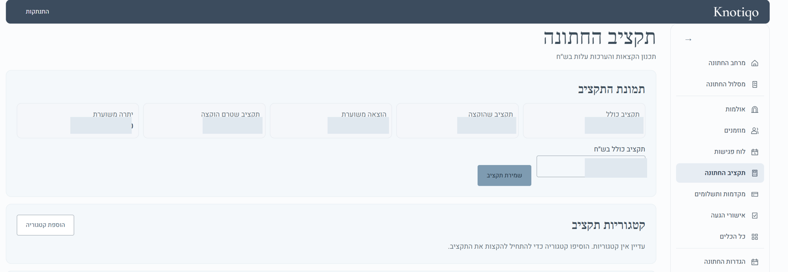
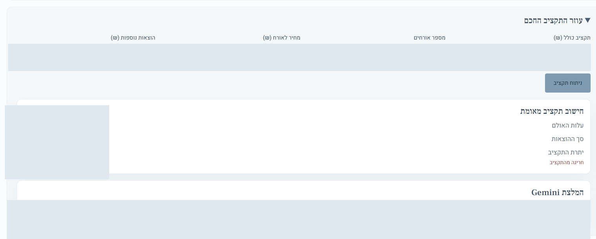
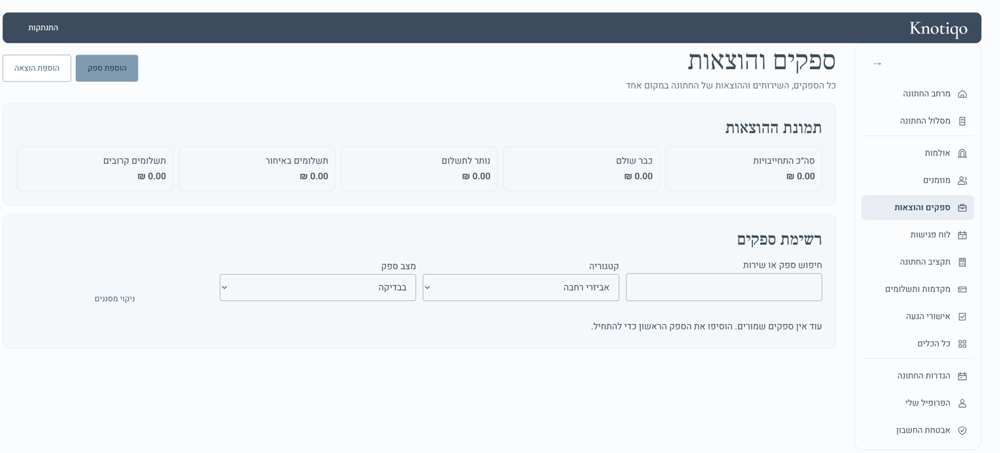

<div align="center">

<h1>Knotiqo</h1>
<p><strong>AI-Powered Wedding Planning &amp; Decision Intelligence</strong></p>
<p>A shared Hebrew RTL workspace where couples can plan their wedding, compare venue quotes, and keep guest lists, supplier commitments and payments in sync.</p>
<p><kbd>React 19</kbd> · <kbd>TypeScript</kbd> · <kbd>Django REST Framework</kbd> · <kbd>PostgreSQL</kbd></p>


<p><em>The Wedding Atelier dashboard. Personal details have been redacted.</em></p>

</div>

## The planning experience

| Area | What couples can do |
| --- | --- |
| **Wedding workspace** | Switch between weddings, invite a partner, edit the wedding date and couple display names, and share a private dashboard cover. |
| **Planning journey** | Follow a staged checklist and update shared progress as planning moves forward. |
| **Venues and quotes** | Save venues and dated quotes, preview website metadata, select photo URLs for the gallery, and compare two to four quotes by calculated cost. |
| **Guests and Excel** | Manage guest records and adult, child and infant counts. Download the official XLSX template, map spreadsheet columns, review duplicates before confirming, and export guest lists. |
| **RSVP** | Generate and revoke individual invitation links and share them manually through WhatsApp. External sharing requires a configured public HTTPS deployment. |
| **Budget and payments** | Set allocations and estimates, record supplier commitments, schedule deposits and other payments, and track amounts actually paid and still due. |
| **Vendors and appointments** | Manage vendor quotes, explicitly link or create budget commitments, and schedule venue tours and supplier meetings in a shared calendar. |
| **Gemini budget assistant** | Ask for guidance on a server-calculated budget scenario. The assistant requires a server-side Gemini API key. |

## Wedding Atelier in use

These are screenshots from the application. Cropping and opaque redactions protect personal and financial details.

<table>
<tr>
<td width="50%" valign="top">
<br>
<strong>Planning journey</strong><br>Shared milestones from early decisions through the wedding.
</td>
<td width="50%" valign="top">
<br>
<strong>Excel import wizard</strong><br>Upload a workbook, map columns and review the rows before saving.
</td>
</tr>
<tr>
<td width="50%" valign="top">
<br>
<strong>Budget planning</strong><br>See allocations, estimates and remaining funds in one place.
</td>
<td width="50%" valign="top">
<br>
<strong>AI budget assistant</strong><br>Review guidance alongside a calculated scenario.
</td>
</tr>
<tr>
<td width="50%" valign="top">
<br>
<strong>Vendor management</strong><br>Organize supplier quotes and follow their commitments.
</td>
<td width="50%" valign="top">
<strong>Venue decisions and shared calendar</strong><br>
Compare minimum guest commitments and quote totals, then keep upcoming meetings visible to both partners.<br>
<a href="backend/venues/COMPARISON_API.md">Quote comparison contract</a> · <a href="backend/weddings/MEETINGS_API.md">Meetings API</a>
</td>
</tr>
</table>

## Architecture and engineering decisions

- **Web client.** [`frontend/`](frontend/) uses React, TypeScript, Vite and custom RTL styles. Hash-based routing keeps a selected wedding in the URL and works with both Vite and the local launcher.
- **Application and persistence.** [`backend/`](backend/) serves Django REST APIs backed by PostgreSQL. Django sessions and CSRF protect authenticated mutations. Wedding membership scopes shared resources, with indistinguishable 404s for missing and inaccessible wedding-owned records.
- **Money and AI.** Backend Decimal calculations drive venue comparison and budget totals. The comparison ranks quotes by lowest calculated cost using billable guests, per-guest price and additional costs. Estimates, commitments, scheduled payments and actual payments have distinct records or totals. Gemini receives the calculated scenario for advisory text. [Budget API](backend/weddings/BUDGET_API.md) · [Assistant implementation](backend/ai_assistant/services.py)
- **Import boundaries.** Guest import uses openpyxl with bounded workbook parsing and a separate, explicit confirmation step. Venue metadata fetching validates destinations and redirects before extracting HTML metadata. PostgreSQL stores temporary preview records and rate limits, and venue galleries persist selected URLs. [Guest import API](backend/weddings/GUEST_IMPORT_API.md) · [Venue image API](backend/venues/IMAGE_API.md)
- **Shared planning and commitments.** Partners work from the same planning checklist, with progressive navigation guiding them through stages. Selecting a vendor quote leaves spending unchanged. Creating a budget commitment requires an explicit confirmation and is limited to one commitment per quote. [Planning journey API](backend/weddings/JOURNEY_API.md) · [Vendor API](backend/weddings/VENDOR_API.md)
- **Sensitive assets and invitations.** Pillow normalizes wedding covers, which are served through membership-checked routes. RSVP links use hashed, expiring and revocable tokens scoped to one guest or family. WhatsApp handoff opens a prefilled message for the user to send. [Cover API](backend/weddings/COVER_API.md) · [RSVP API](backend/weddings/RSVP_API.md)

## Run locally

The commands below use Windows PowerShell from the repository root. Install Python 3.12, Node.js 24 and PostgreSQL. Create a local PostgreSQL database and assign a database role that can run migrations.

Create `backend/.env` with the following values. Replace the placeholders with your local database credentials and keep the file private.

```dotenv
DB_NAME=knotiqo
DB_USER=your_local_role
DB_PASSWORD=your_local_password
DB_HOST=127.0.0.1
DB_PORT=5432
```

Set `GEMINI_API_KEY` in the same file to enable AI guidance. Leave `PUBLIC_BASE_URL` unset for local use to keep external RSVP sharing disabled.

Start Django in the first terminal.

```powershell
py -3.12 -m venv .\backend\.venv
Set-Location .\backend
.\.venv\Scripts\python.exe -m pip install -r requirements.txt
.\.venv\Scripts\python.exe manage.py migrate
.\.venv\Scripts\python.exe manage.py runserver 127.0.0.1:8000
```

Start Vite in a second terminal opened at the repository root. Open `http://localhost:5173/` in your browser.

```powershell
Set-Location .\frontend
npm ci
npm run dev
```

The optional Windows launcher serves the Vite build and API on one loopback origin with Waitress. It can create desktop shortcuts for opening and stopping Knotiqo. [Windows launcher setup](backend/README.local.md)

## Verification commands

Run the backend commands from `backend/` with a PostgreSQL role that can create Django's test database.

```powershell
.\.venv\Scripts\python.exe manage.py check
.\.venv\Scripts\python.exe manage.py makemigrations --check --dry-run
.\.venv\Scripts\python.exe manage.py test
```

Run the frontend commands from `frontend/`.

```powershell
npm test
npm run build
npm run lint
```

## Project status

Knotiqo has a documented local development workflow and a loopback-only Windows launcher. Public RSVP sharing requires a real HTTPS deployment, a configured `PUBLIC_BASE_URL`, and deployment-level verification. The local setup does not establish that guests can reach the app from another device.

Possible next steps include seating charts and invitation design.

---

Knotiqo is a full-stack portfolio project focused on shared planning, trustworthy calculations and practical workflows for couples.
